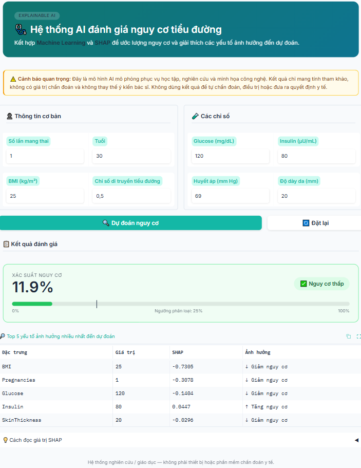
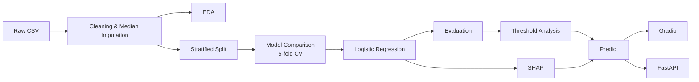
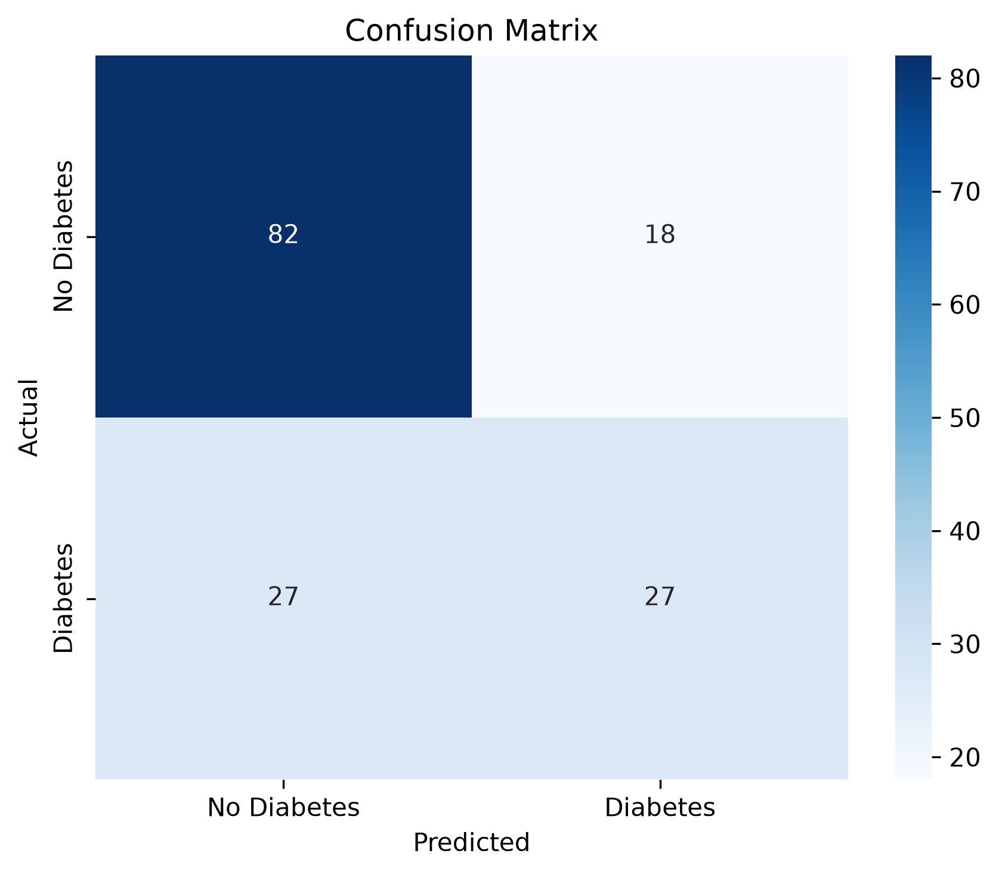
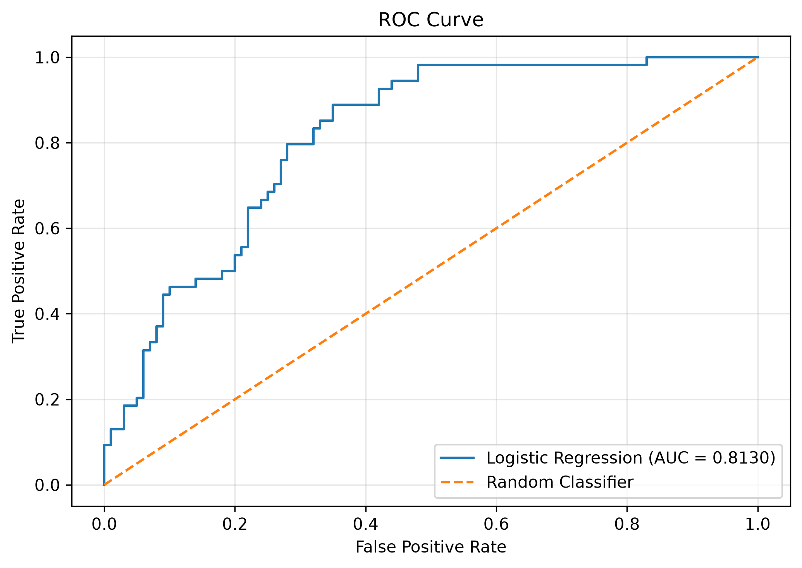
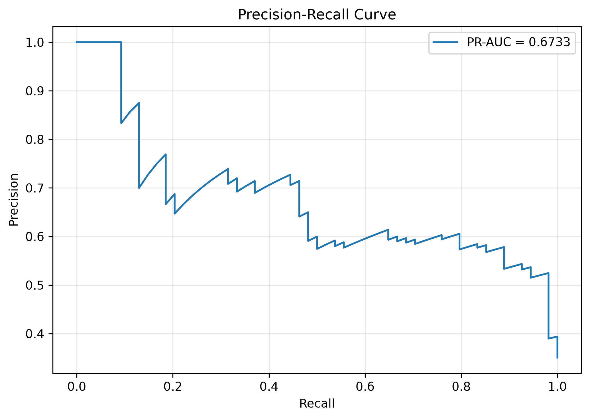
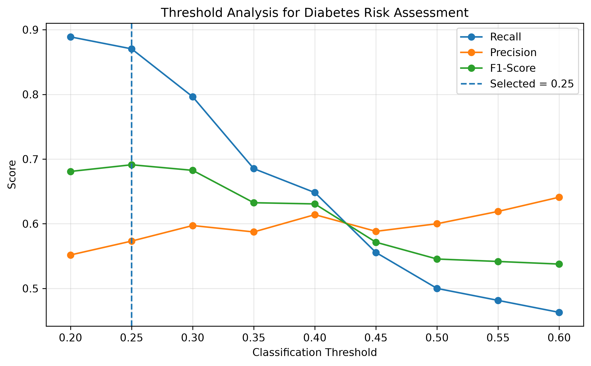
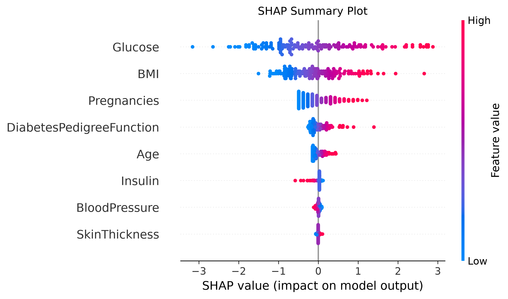
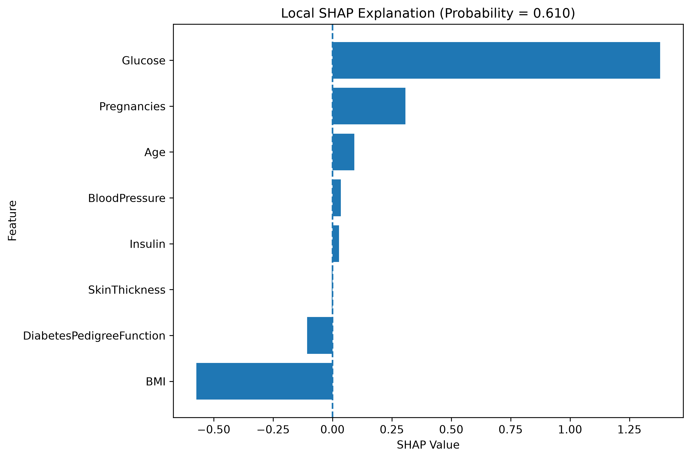

# 🩺 Explainable AI-Based Diabetes Risk Assessment


An end-to-end machine learning project that **estimates diabetes risk and explains every prediction with SHAP**. It covers data cleaning, exploratory data analysis, model comparison, threshold tuning, explainability, and two ways to use the model: an interactive **Gradio** app and a **FastAPI** endpoint.

> ⚠️ **Disclaimer:** Educational and research use only. This is not a medical device and must not be used to diagnose diabetes, guide treatment, or replace advice from a qualified healthcare professional.

---

## 📌 Highlights

| | |
|---|---|
| **Dataset** | Pima Indians Diabetes: 768 samples, 8 features (500 negative / 268 positive) |
| **Best model** | Logistic Regression (5-fold stratified CV ROC-AUC **0.8428**) |
| **Hold-out performance** | ROC-AUC **0.8130** · PR-AUC **0.6733** |
| **Threshold tuning** | Recall **0.50 → 0.87** and false negatives **27 → 7** when the threshold moves from 0.50 to 0.25 |
| **Explainability** | Global and local SHAP; top drivers are Glucose, BMI, and Pregnancies |
| **Interfaces** | Gradio web app · FastAPI REST endpoint |

---

## 🖥️ Demo

### Gradio web application

Enter the eight clinical features and the app returns the estimated probability, a risk category, and the top SHAP contributors for that input.



**Sample input** used in the demo:

| Feature | Value | Feature | Value |
|---|---:|---|---:|
| Pregnancies | 1 | BMI | 25 |
| Glucose | 120 | Diabetes pedigree function | 0.5 |
| Blood pressure | 70 | Age | 30 |
| Skin thickness | 20 | Insulin | 80 |

Launch the app:

```bash
python app/gradio_app.py       
```

### REST API (FastAPI)

```bash
python -m uvicorn app.api:app      
```

---

## 🔄 Pipeline



**Preprocessing:** remove duplicate rows → treat zeros in `Glucose`, `BloodPressure`, `SkinThickness`, `Insulin`, and `BMI` as missing → impute with each feature's median → save to `data/diabetes_clean.csv`.

---

## 📊 Results

### Model comparison (5-fold stratified CV, ROC-AUC)

| Model | Mean ROC-AUC | Std |
|---|---:|---:|
| **Logistic Regression** ✅ | **0.8428** | 0.0190 |
| Random Forest | 0.8225 | 0.0225 |
| Gradient Boosting | 0.8191 | 0.0183 |
| Decision Tree | 0.7683 | 0.0289 |

The comparison chart (`results/figures/00_model_comparison.png`) shows the mean cross-validated ROC-AUC of the four models side by side. Logistic Regression has the highest score, followed closely by Random Forest and Gradient Boosting, while Decision Tree is clearly the lowest. Logistic Regression also has a small standard deviation across folds, which indicates stable performance.

Logistic Regression achieves the highest cross-validated ROC-AUC and is the most transparent baseline for SHAP analysis.

### Hold-out test set (20%, `random_state=42`, threshold 0.50)

| Accuracy | Precision | Recall | F1 | ROC-AUC | PR-AUC |
|---:|---:|---:|---:|---:|---:|
| 0.7078 | 0.6000 | 0.5000 | 0.5455 | **0.8130** | **0.6733** |

<table>
  <tr>
    <td align="center" width="33%"><b>Confusion Matrix</b><br></td>
    <td align="center" width="33%"><b>ROC Curve</b><br></td>
    <td align="center" width="33%"><b>Precision–Recall Curve</b><br></td>
  </tr>
</table>

The ROC-AUC shows that the model ranks positive cases above negative ones reasonably well. At the default threshold of 0.50, however, it **misses 27 of 54 positive cases** (Recall = 0.50). This motivates the threshold analysis below.

---

## 🎚️ Threshold Analysis: 0.50 vs 0.25

Thresholds from 0.20 to 0.60 were compared. The selection rule requires **Recall ≥ 0.65 and Precision ≥ 0.45**, then maximizes F1-score.

| Metric | Default (0.50) | Selected (0.25) | Change |
|---|---:|---:|---:|
| Precision | 0.6000 | 0.5732 | −0.027 |
| **Recall** | 0.5000 | **0.8704** | **+0.370** |
| **F1-score** | 0.5455 | **0.6912** | **+0.146** |
| True positives | 27 | **47** | +20 |
| **False negatives** | 27 | **7** | **−20** |

**Confusion matrices at 0.50 and 0.25** (`14_threshold_confusion_matrices.png`): the figure places the two confusion matrices side by side for the 154 test samples (100 negative, 54 positive). At the default threshold of 0.50, the model finds 27 of the 54 positive cases and misses the other 27 (false negatives). At the selected threshold of 0.25, it finds 47 positive cases and misses only 7. The cost of this change is more false alarms: the number of false positives rises, which is why precision drops slightly from 0.6000 to 0.5732.



Lowering the threshold trades a small drop in precision for a large gain in recall, which suits a **risk-screening** setting where missed positives are costly. ROC-AUC is unchanged because it depends on the ranking of probabilities, not on the cutoff. The threshold of 0.25 is an experimental choice and is **not clinically validated**.

> **Methodology note:** The threshold was chosen and reported on the same hold-out split, so these figures are optimistic. For a final evaluation, select the threshold on a validation set or cross-validated predictions, then report performance once on an untouched test set.

---

## 🧠 Explainability with SHAP

SHAP (SHapley Additive exPlanations) shows how each feature pushes a prediction up or down, both across the dataset and for a single input.

### Global feature importance

| Rank | Feature | Mean \|SHAP\| |
|---:|---|---:|
| 1 | Glucose | 1.0325 |
| 2 | BMI | 0.5736 |
| 3 | Pregnancies | 0.3441 |
| 4 | DiabetesPedigreeFunction | 0.1699 |
| 5 | Age | 0.1172 |
| 6 | Insulin | 0.0562 |
| 7 | BloodPressure | 0.0317 |
| 8 | SkinThickness | 0.0188 |



High values of Glucose, BMI, Pregnancies, and Age (red) push predictions toward higher risk.

### Local explanation

The waterfall plot below explains one prediction, the sample patient from the demo.



> SHAP explains **how the model behaves**. It does not show that a feature causes diabetes.

---

## 🔎 Exploratory Data Analysis

The EDA step (`python src/eda.py`) produces four figures in `results/figures/`. They are described below.

- **Outcome distribution** (`01_outcome_distribution.png`): a count plot of the target variable. The classes are imbalanced, with 500 non-diabetic samples (about 65%) versus 268 diabetic samples (about 35%). This imbalance is why stratified splitting, ROC-AUC, PR-AUC, and threshold tuning are used instead of accuracy alone.
- **Correlation matrix** (`03_correlation_matrix.png`): a heatmap of pairwise correlations between the eight features and the outcome. Glucose shows the strongest relationship with the outcome, followed by BMI, Age, and Pregnancies. Among the features themselves, Age and Pregnancies are moderately correlated, as are BMI and SkinThickness, and Glucose and Insulin. No pair is so strongly correlated that it blocks the use of Logistic Regression.
- **Feature distributions** (`02_feature_distributions.png`): histograms of each feature after cleaning. Several features, such as Pregnancies, Age, Insulin, and DiabetesPedigreeFunction, are right-skewed, while Glucose, BloodPressure, and BMI are closer to bell-shaped. After median imputation, some features show a visible spike at their median value, which comes from the filled-in zeros.
- **Key features by outcome** (`04_key_features_vs_outcome.png`): box plots (or similar group comparisons) of the most informative features split by outcome. Diabetic cases tend to have higher Glucose and BMI, and also higher Age and Pregnancies, than non-diabetic cases. The distributions still overlap, so no single feature separates the two groups perfectly. This agrees with the SHAP ranking above.

---

## 🚀 Quick Start

```bash
git clone <YOUR_GITHUB_REPOSITORY_URL>
cd <YOUR_REPOSITORY_FOLDER>

conda create -n diabetes-ai python=3.11 -y
conda activate diabetes-ai
python -m pip install -r requirements.txt
```

Run the pipeline in order from the project root:

```bash
python src/data_processing.py       # 1. clean data
python src/eda.py                   # 2. EDA figures
python src/train.py                 # 3. train and compare models
python src/evaluate.py              # 4. evaluation metrics and plots
python src/threshold_analysis.py    # 5. threshold selection (creates selected_threshold.csv)
python src/explain.py               # 6. SHAP explanations
python src/predict.py               # 7. sample prediction
```

Regenerate the README figures:

```bash
python src/plot_model_comparison.py   # 00_model_comparison.png
python src/make_demo_figures.py       # 12_shap_local_explanation.png, 14_threshold_confusion_matrices.png
```

Then launch an interface:

```bash
python app/gradio_app.py                      
python -m uvicorn app.api:app     
```

> Steps 1–5 must run first. The apps need `models/best_model.pkl` and `results/reports/selected_threshold.csv`.

---

## 🗂️ Project Structure

```text
├── data/           diabetes.csv, diabetes_clean.csv
├── models/         best_model.pkl, feature_names.pkl
├── src/            data_processing, eda, train, evaluate, threshold_analysis,
│                   explain, predict, plot_model_comparison, make_demo_figures
├── app/            gradio_app.py, api.py
├── results/
│   ├── figures/    EDA, evaluation, threshold, SHAP, and demo figures
│   └── reports/    CSV and TXT metric reports
├── main.py
├── requirements.txt
└── README.md
```

## 🧰 Tech Stack

Python · Pandas · NumPy · scikit-learn · Matplotlib · Seaborn · SHAP · Joblib · Gradio · FastAPI · Uvicorn

---

## 🚧 Limitations and Next Steps

**Limitations**
- The dataset is small and covers a limited population, so results may not generalize.
- At the default threshold, recall is only 0.50. The 0.25 threshold is experimental.
- The threshold was selected on the same test split that is reported, so results are optimistic.
- SHAP explains the model, not causal relationships.
- Predictions depend on input quality, units, and preprocessing consistency.

**Next steps**
- Wrap preprocessing and the model in a single scikit-learn `Pipeline` so training and inference apply identical transforms.
- Use repeated cross-validation and an external validation set.
- Add calibration, subgroup analysis, and uncertainty estimates.
- Add input validation, unit hints, automated tests, and logging.
- Obtain domain-expert review before any real-world healthcare use.

---

## ⚠️ Disclaimer

This is a student and educational machine learning project. It is not a clinically validated diagnostic system. Probabilities and risk labels are statistical outputs, not medical diagnoses. Consult qualified healthcare professionals for medical assessment.